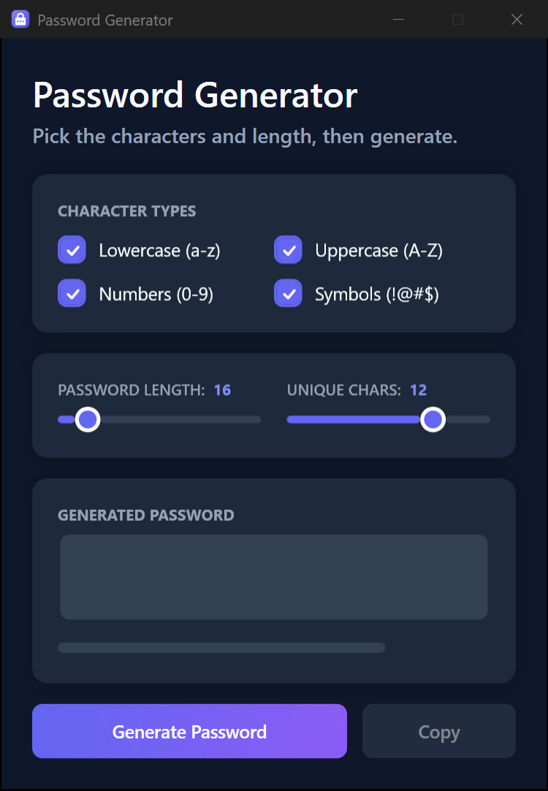
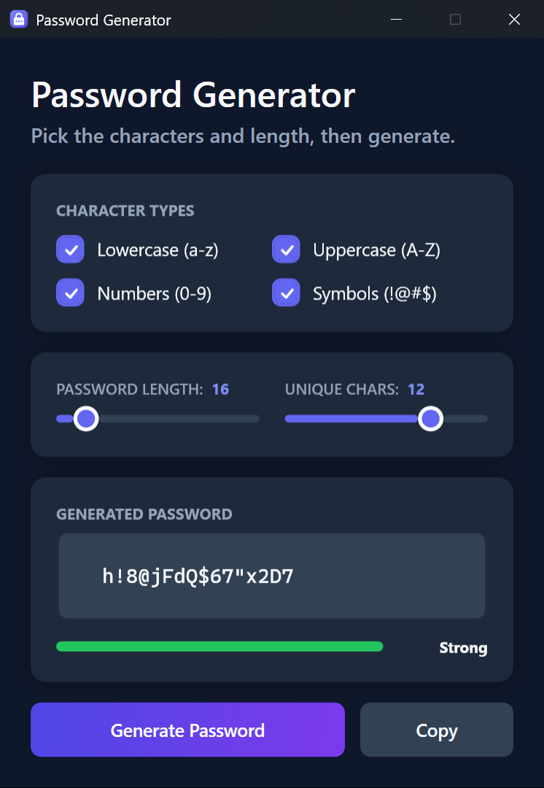

# Password Generator

[](https://github.com/haseebn19/passgen/actions/workflows/ci.yml)


A Windows password generator with configurable character sets and live strength estimates.

## Screenshots





## Features

- **Character Options**: Lowercase, uppercase, numbers, and symbols
- **Password Length**: Configurable from 4 to 128 characters
- **Unique Characters**: Guarantee a minimum number of unique characters
- **Strength Indicator**: Real-time evaluation with zxcvbn, for generated or pasted passwords
- **System Theme**: Follows Windows dark/light mode, including changes while the app is open
- **Private Copy**: One-click copy that Windows keeps out of clipboard history and cloud sync

## Prerequisites

- Windows 10/11
- [.NET 10 Desktop Runtime](https://dotnet.microsoft.com/download/dotnet/10.0) to run the app
- [.NET 10 SDK](https://dotnet.microsoft.com/download/dotnet/10.0) to build it

## Installation

```powershell
git clone https://github.com/haseebn19/passgen.git
cd passgen
dotnet restore
```

## Usage

```powershell
cd PassgenWPF
dotnet run
```

1. Select character types to include
2. Adjust password length and unique character count
3. Click **Generate Password**
4. Click **Copy** to copy it

To check an existing password's strength, type or paste it into the password box.

## Development

### Testing

```powershell
dotnet test
```

With coverage:

```powershell
dotnet test --collect:"XPlat Code Coverage"
```

### Linting

```powershell
dotnet format --verify-no-changes
dotnet build
```

Code style rules live in `.editorconfig`. The .NET analyzers run during the build, and `dotnet format` fixes formatting.

## Building

```powershell
dotnet publish PassgenWPF -c Release
```

Output: `PassgenWPF/bin/Release/net10.0-windows/win-x64/publish/Passgen.exe`

## Project Structure

```text
passgen/
+-- PassgenWPF/              Main application
|   +-- Converters/          Strength meter converter
|   +-- Helpers/             Theme, title bar, and clipboard utilities
|   +-- Services/            Password generation
|   +-- Themes/              Dark and light color schemes
|   +-- ViewModels/          MVVM view models
|   +-- Views/               XAML windows
+-- PassgenWPF.Tests/        xUnit tests
+-- docs/                    Screenshots
```

## Credits

- [CommunityToolkit.Mvvm](https://github.com/CommunityToolkit/dotnet) - MVVM infrastructure
- [zxcvbn-core](https://github.com/trichards57/zxcvbn-cs) - Password strength estimation

## License

This project is licensed under the [MIT License](LICENSE).
